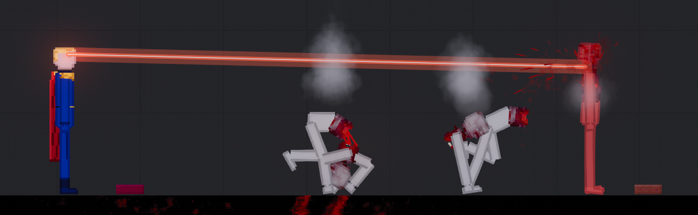

# PPLua: Lua-моды для People Playground в песочнице

[](https://github.com/heisenberg1234567891000-ship-it/PPLua/actions/workflows/tests.yml)
[](https://github.com/heisenberg1234567891000-ship-it/PPLua/releases/latest)
[](LICENSE)

[English](README.md) · **Русский**

PPLua — **неофициальный** загрузчик модов, который возвращает в People Playground моды с кодом, но на Lua и в
песочнице. Проверен на People Playground 1.27.18. Studio Minus к нему отношения не имеет.

После вирусной атаки через мастерскую в сентябре 2026 года моды на C# из игры убрали. Мод на C# — это
программа .NET с полным доступом к компьютеру. Мод на PPLua — это Lua-скрипт, которому доступен только игровой
мир: он добавляет предметы и категории, управляет физикой, людьми и конечностями, устраивает взрывы,
проигрывает звуки, меняет спрайты, добавляет горячие клавиши и кнопки в контекстном меню. При этом у него
**нет доступа к файлам, сети, другим программам и .NET**. Каждый мод работает в своём интерпретаторе с лимитом
инструкций, поэтому сломанный или вредный мод останавливается, а игра не зависает.



- [Установка](#установка) · [Безопасность](#безопасность) · [Как написать мод](#как-написать-мод) ·
  [Справочник API](docs/API.ru.md) · [Сборка](#сборка-из-исходников) · [Список изменений](CHANGELOG.md)

## Возможности

- **Предметы и категории.** Возьмите любой предмет каталога за основу, дайте ему спрайт, иконку и поведение на
  Lua и положите в свою категорию.
- **Объекты.** Позиция, скорость, масса, гравитация, температура, заряд, огонь, материалы, мягкость, упругость,
  сварка, шарниры, свет, украшения, кнопки в контекстном меню и хуки на активацию, кадр, столкновение, укол и
  попадание пули.
- **Люди и конечности.** Здоровье, боль, шок, сознание, позы и ходьба, переломы, отрыв конечностей, сила мышц,
  прочность, регенерация, неуязвимость, буфер урона и перекраска скина с сохранением теней игры.
- **Сборка тела.** Мод запоминает, как собрано тело, и потом возвращает оторванные конечности на место или
  выращивает раздавленные заново.
- **Мир.** Спавн, взрывы, импульсы, ЭМИ, частицы, лучи-рейкасты, линии-лучи, спрайты без физики и лёгкие
  физические объекты из своих спрайтов.
- **Звук.** Разовые звуки, управляемые зацикленные источники и звуки материалов из самой игры.
- **Ввод, таймеры и хранилище.** Клавиши и мышь, таймеры в игровом времени и до 256 КБ сохранённых данных на мод.
- **Окно F8.** Список модов с их состоянием, последние ошибки и строки лога, включение и выключение модов.
- **Исправления MoonSharp.** PPLua чинит две ошибки MoonSharp 2.0, которые незаметно портят переменные (см.
  [список изменений](CHANGELOG.md)), так что обычный Lua работает как обычный Lua.

## Установка

1. Скачайте **BepInEx 5.4.23.5 (x64)** с официальной страницы релиза:
   <https://github.com/BepInEx/BepInEx/releases/tag/v5.4.23.5>. Нужен файл `BepInEx_win_x64_5.4.23.5.zip`,
   его SHA-256: `82f9878551030f54657792c0740d9d51a09500eeae1fba21106b0c441e6732c4`.
2. Откройте папку игры (Steam → People Playground → Управление → Просмотреть локальные файлы) и распакуйте туда
   BepInEx. Рядом с `People Playground.exe` должны появиться `winhttp.dll`, `doorstop_config.ini` и папка `BepInEx`.
3. Скачайте `PPLua-<версия>.zip` со страницы [Releases](../../releases) и распакуйте в ту же папку. Появятся
   `BepInEx/plugins/PPLua/` и `LuaMods/`.
4. Запустите игру. Когда загрузится карта, появится уведомление «PPLua: N Lua mod(s) running». Клавиша **F8**
   открывает список модов.

У каждого релиза есть файл `SHA256SUMS.txt` с хешами. Проверить скачанный архив в PowerShell:

```powershell
Get-FileHash .\PPLua-0.8.0.zip -Algorithm SHA256
```

**Linux и Steam Deck (Proton):** в параметрах запуска игры в Steam укажите
`WINEDLLOVERRIDES="winhttp=n,b" %command%`.

### Как поставить Lua-мод

Положите папку мода (ту, в которой лежит `mod.json`) в `People Playground/LuaMods/` и перезапустите игру.
Чтобы выключить мод, снимите с него галочку в окне F8; это сработает после перезапуска.

### Удаление

Удалите из папки игры `winhttp.dll`, `doorstop_config.ini`, `.doorstop_version`, `BepInEx/` и `LuaMods/`. Затем
выполните в Steam «Проверить целостность файлов игры», чтобы игра точно вернулась в исходное состояние.

## Безопасность

Сам по себе Lua не безопасен. Безопасность PPLua держится на том, **что именно** дано моду. Каждый мод получает
свой интерпретатор [MoonSharp](https://www.moonsharp.org/) (Lua 5.2, написанный на C#), и загрузчик решает, что
в этом интерпретаторе видно.

| Мод не может | Как это обеспечено |
|---|---|
| Читать, писать и удалять файлы | `io`, `load`, `loadfile`, `dofile`, `debug`, `string.dump` и `os.execute/remove/rename/exit/getenv/tmpname` удалены. `require` загружает только `.lua` из папки самого мода |
| Загружать файлы не из своей папки | Каждый путь проверяется: `..`, абсолютные пути, буквы дисков и потоки NTFS (`файл:поток`) отклоняются. Загружаются только `.png/.jpg` (до 16 МБ) и `.wav/.mp3` (до 32 МБ) |
| Выходить в сеть и запускать программы | Таких функций в API нет |
| Трогать .NET, Unity и рефлексию | Lua не получает ни одного .NET-объекта. Объекты игры приходят в Lua как «ручки»: пустые таблицы с закрытой метатаблицей, а настоящий объект остаётся на стороне C# |
| Повесить игру бесконечным циклом | Каждый вызов Lua может выполнить 20 млн инструкций (около 0,2 с). Превысил — мод останавливается навсегда, и `pcall` эту остановку не перехватит |
| Мешать другим модам | У каждого мода свой интерпретатор, свои глобальные переменные и своё хранилище |

**Что мод может:** всё в пределах игрового мира. Спавнить и удалять объекты, убивать и лечить людей,
устраивать взрывы и менять физику. Он читает клавиши, пока игра в фокусе, и хранит до 256 КБ своих данных
(`ppg.save`) в `BepInEx/config/PPLua/storage/<мод>.json`.

**Известные ограничения:**

- Мод всё ещё может исчерпать память (например, удваивая строку в цикле), и игра упадёт. Файлы при этом не
  пострадают.
- Сам загрузчик (`PPLua.dll`) и BepInEx — обычный .NET-код с полными правами, им приходится доверять. Поэтому
  исходники открыты, а у каждого релиза опубликованы SHA-256. Берите BepInEx только с его официального GitHub.
- Песочницу проверяют автоматические тесты (`tests/SandboxTests`) и тесты прямо в игре (`tests/PPLuaProbe`,
  `tests/BadLoopMod`). Это не аудит. Если найдёте способ выбраться из песочницы, сообщите об этом закрыто, как
  описано в [SECURITY.md](SECURITY.md).

## Как написать мод

Минимальный мод — папка `LuaMods/MyMod/` с двумя файлами.

`mod.json`:

```json
{ "name": "My Mod", "author": "я", "description": "Что он делает", "version": "1.0", "main": "main.lua" }
```

`main.lua`:

```lua
local spr = ppg.sprite("sprites/ball.png")   -- путь относительно папки мода

ppg.register_item{
  original = "Brick",                 -- какой предмет каталога взять за основу
  name = "Lua Ball",
  description = "Подпрыгивает при активации",
  category = "Misc.",
  thumbnail = spr,
  after_spawn = function(obj)
    obj:set_sprite(spr)
    obj:on_use(function(self) self:impulse(0, 10) end)
  end,
}

ppg.on("map_loaded", function() ppg.notify("Привет из Lua!") end)
```

`main.lua` выполняется один раз при запуске игры. В нём регистрируются предметы, категории и события, а всё,
что меняет мир, делается из событий вроде `map_loaded`. Ошибки пишутся в `BepInEx/LogOutput.log` и в окно F8;
мод, выдавший больше 20 ошибок за 5 секунд, останавливается.

Полный справочник: [docs/API.ru.md](docs/API.ru.md) ([на английском](docs/API.md)).

### Пример в комплекте: Хоумлендер

[LuaMods/Homelander](LuaMods/Homelander/main.lua) — фанатский Хоумлендер, сделанный только на вызовах PPLua.
В нём большая часть API работает вместе: костюм, нарисованный поверх скина игры, плащ, лазеры из глаз, которые
жгут и режут, полёт, рывок с ударом, ударная волна, неуязвимость и регенерация. Ищите его в категории **Supes**
(меню «+» с дополнительными категориями).

| Клавиша | Действие |
|---|---|
| **H** (держать) | Лазеры из глаз в сторону курсора |
| **J** | Взлететь или приземлиться |
| **R** (держать) | Лететь к курсору |
| **N** | Рывок с ударом в сторону курсора |
| **B** | Ударная волна в сторону курсора |

В мод входит синтезированный звук лазера. Чтобы поставить свой, положите его в
`LuaMods/Homelander/sounds/laser.mp3`. Внешность тоже можно заменить своими `custom/skin.png` и `custom/cape.png`.
Подробности в [README.txt мода](LuaMods/Homelander/README.txt).

## Настройки

При первом запуске BepInEx создаёт `BepInEx/config/pplua.loader.cfg`.

| Раздел | Ключ | По умолчанию | Что значит |
|---|---|---|---|
| `Mods` | `Disabled` | (пусто) | Имена папок модов через запятую, которые не надо запускать. Галочки в F8 меняют именно его |
| `UI` | `OverlayKey` | `F8` | Клавиша окна со списком модов |
| `Sandbox` | `InstructionBudget` | `20000000` | Сколько инструкций Lua может выполнить один вызов, прежде чем мод остановят |

## Если что-то не работает

| Что видно | Что проверить |
|---|---|
| На карте нет уведомления «PPLua» | `winhttp.dll` должен лежать рядом с `People Playground.exe`, а после запуска должен появиться `BepInEx/LogOutput.log`. В Proton укажите параметр запуска, см. выше |
| Мода нет в списке F8 | `mod.json` должен лежать прямо в папке мода, а не во вложенной папке |
| У мода написано «failed to start» | `main.lua` выдал ошибку при загрузке. Выберите мод в F8, чтобы её увидеть |
| У мода написано «stopped» | Выберите его в F8, чтобы увидеть последнюю ошибку. Мод останавливается после более чем 20 ошибок за 5 секунд или если один вызов превысил лимит инструкций |
| Ошибки «no longer exists» | Объект удалён. Проверяйте `obj:exists()`, прежде чем пользоваться сохранённой ручкой |

## Сборка из исходников

Нужен [.NET SDK](https://dotnet.microsoft.com/download) 8 или новее. Для сборки самого плагина нужна ещё игра
с установленным BepInEx 5.4.23.5: плагин компилируется с DLL игры. Эти DLL читаются только во время сборки;
ничего из игры не попадает ни в репозиторий, ни в релиз.

```bash
dotnet build src/PPLua.csproj -c Release -p:GameDir="C:\Program Files (x86)\Steam\steamapps\common\People Playground"
dotnet run --project tests/SandboxTests -c Release
python tools/package.py
```

Плагин собирается в `src/bin/Release/PPLua.dll`. `tools/package.py` создаёт `dist/PPLua-<версия>.zip` и
`dist/SHA256SUMS.txt`.

Тестам песочницы игра **не** нужна. Без неё они берут HarmonyX из NuGet; так их запускает GitHub Actions при
каждом push. Тесты в игре описаны в [tests/README.md](tests/README.md).

### Устройство репозитория

| Путь | Что там |
|---|---|
| `src/` | Плагин BepInEx: песочница, Lua-API, ручки, сборка тела и исправления MoonSharp |
| `LuaMods/Homelander/` | Мод-пример из комплекта |
| `docs/` | Справочник API на английском и русском |
| `tests/SandboxTests/` | Тесты на побег из песочницы и зависание, запускаются без игры |
| `tests/PPLuaProbe/`, `tests/BadLoopMod/`, `tests/HomelanderLab/` | Тестовые моды для игры |
| `tools/` | Сборка релиза и скрипт, который рисует арт и синтезирует звуки Хоумлендера |

## Участие

Сообщения об ошибках, идеи для API и pull request'ы приветствуются; начните с [CONTRIBUTING.md](CONTRIBUTING.md).
О способах выбраться из песочницы сообщайте закрыто, как описано в [SECURITY.md](SECURITY.md).

## Лицензия и авторы

PPLua распространяется по [лицензии MIT](LICENSE). MoonSharp (BSD-3-Clause) входит в архив; BepInEx (LGPL-2.1)
скачивается отдельно. Подробнее в [THIRD-PARTY-NOTICES.md](THIRD-PARTY-NOTICES.md).

Загрузчик и пример Хоумлендера написаны с помощью ИИ (Claude от Anthropic). Арт и звуки Хоумлендера нарисованы
и синтезированы скриптом [tools/make_homelander_assets.py](tools/make_homelander_assets.py).

People Playground — игра Studio Minus. PPLua не содержит файлов игры, не связан со Studio Minus и не одобрен ею.
Мод Homelander — неофициальное фанатское творчество, не связанное с The Boys, Amazon и Sony Pictures Television.
